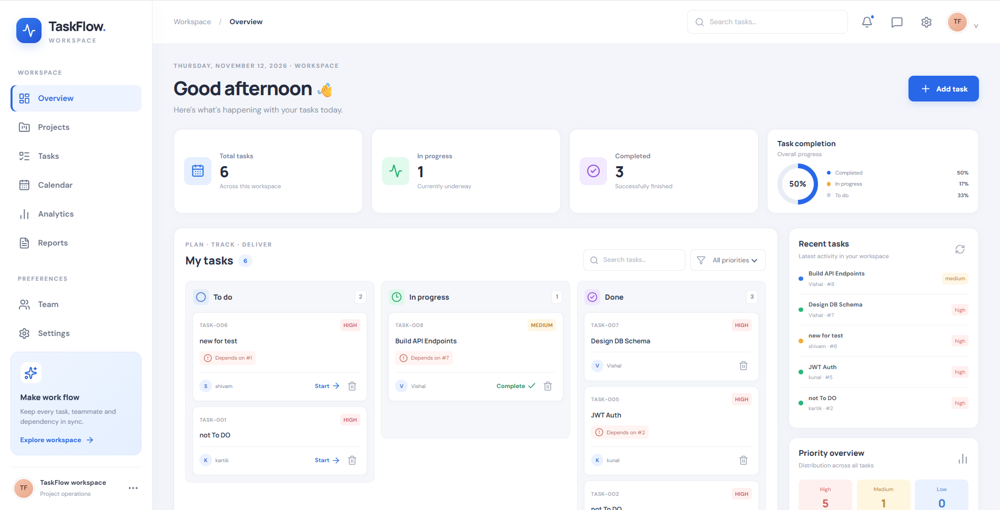
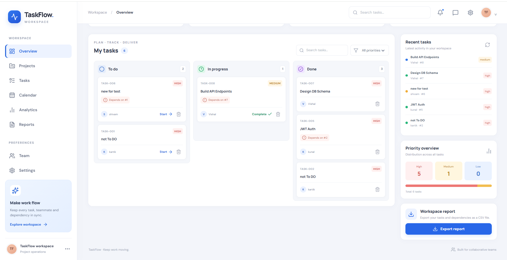
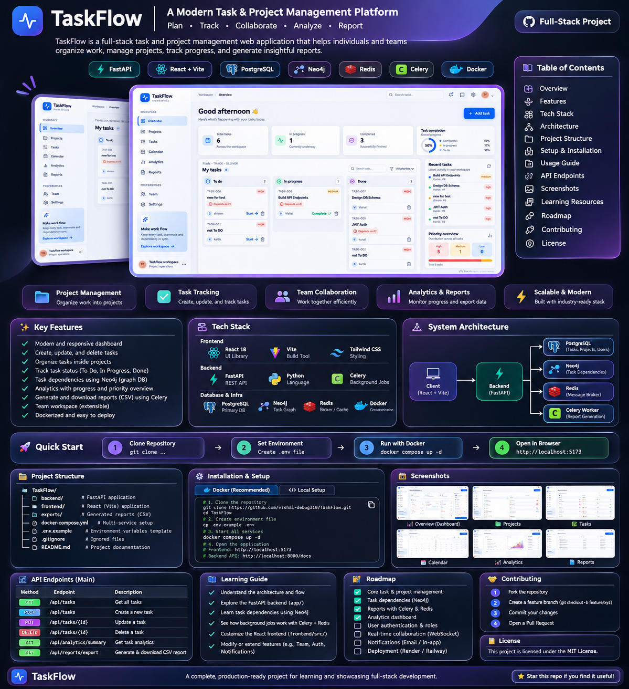
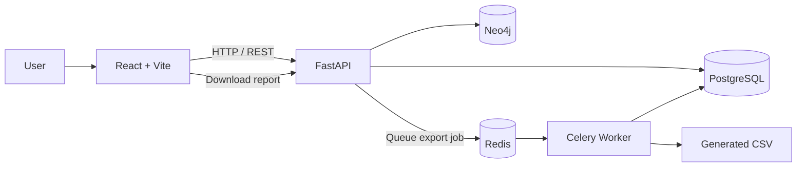

<div align="center">

# ⚡ TaskFlow

### Plan · Track · Collaborate · Deliver

**A full-stack task management workspace with dependency tracking and asynchronous CSV reporting.**

[](https://www.python.org/)
[](https://fastapi.tiangolo.com/)
[](https://react.dev/)
[](https://www.postgresql.org/)
[](https://neo4j.com/)
[](https://redis.io/)
[](https://docs.celeryq.dev/)
[](https://www.docker.com/)

[Features](#-features) · [Architecture](#-architecture) · [Quick Start](#-quick-start) · [API](#-api-reference) · [Learning Guide](#-learning-guide)

</div>

---

## 👀 Overview

TaskFlow is a full-stack task management application designed to make day-to-day work easier to organize and monitor. It combines a React dashboard with a FastAPI backend, PostgreSQL for application data, Neo4j for task-dependency relationships, and Celery with Redis for background report generation.

It is also a practical learning resource: explore how a frontend communicates with REST APIs, how relational and graph databases solve different problems, and how long-running work can be moved out of an HTTP request into a background worker.

## 🖥️ Application Preview

### Workspace dashboard


### Kanban task board


### Project overview infographic


## ✨ Features

| Feature | What it does | What you can learn |
|---|---|---|
| Workspace dashboard | Summarizes tasks, completion progress, recent activity and priorities | Data-driven dashboard UI |
| Task management | Create, view, update and delete tasks | REST API and CRUD operations |
| Kanban workflow | Organizes tasks into To do, In progress and Done | UI state and workflow design |
| Task priorities | Supports Low, Medium and High priority | Data modelling and filtering |
| Task dependencies | Represents relationships between dependent tasks | Graph modelling with Neo4j |
| Analytics | Summarizes task status and priority distribution | Aggregation and visualization |
| CSV report export | Runs report generation in the background and downloads the CSV | Celery, Redis and async jobs |
| Docker Compose | Runs the services together | Containerized development |

> **Scope note:** The screenshots show the current workspace UI. Authentication, real-time collaboration, persistent team management, and complete project/calendar workflows should only be described as implemented after their end-to-end workflows are complete.

## 🧰 Tech Stack

**Frontend**
- React — component-based UI
- Vite — frontend development server and build tooling
- JavaScript — application logic and API integration
- CSS — layout, styling and responsive presentation

**Backend**
- Python and FastAPI — REST API
- Pydantic — request and response validation
- SQLAlchemy — relational database access

**Data and background processing**
- PostgreSQL — structured task data
- Neo4j — task dependency relationships
- Redis — Celery message broker
- Celery — asynchronous report generation

**Development and testing**
- Docker / Docker Compose
- Pytest

## 🏗️ Architecture



### Why these services?

- **PostgreSQL** stores structured records such as tasks, statuses, priorities and assignees.
- **Neo4j** represents connected data. Task dependencies can be stored as graph relationships.
- **Redis + Celery** move slower report-generation work out of the API request. The API can return a job identifier while a worker processes the export.

### CSV export flow

1. The frontend requests a report.
2. FastAPI queues a Celery task through Redis.
3. A Celery worker reads task data.
4. The worker generates a CSV file.
5. The frontend checks job status and downloads the completed file.

## 📁 Project Structure

```text
TaskFlow/
├── backend/
│   ├── app/
│   │   ├── api/
│   │   │   └── routes.py          # API endpoints
│   │   ├── core/
│   │   │   ├── database.py        # PostgreSQL / SQLAlchemy setup
│   │   │   └── neo4j_db.py        # Neo4j connection
│   │   ├── models/
│   │   │   ├── schemas.py         # Pydantic schemas
│   │   │   └── task_model.py      # Task model
│   │   ├── worker/
│   │   │   └── celery_app.py      # Celery configuration and jobs
│   │   └── main.py                # FastAPI entry point
│   ├── tests/
│   │   └── test_api.py            # API tests
│   ├── Dockerfile
│   └── requirements.txt
├── frontend/
│   ├── public/
│   ├── src/
│   │   ├── assets/
│   │   ├── App.jsx
│   │   ├── App.css
│   │   ├── index.css
│   │   └── main.jsx
│   ├── index.html
│   ├── package.json
│   └── vite.config.js
├── exports/                       # Generated CSV reports (not committed)
├── .env.example
├── .gitignore
└── docker-compose.yml
```

## 🚀 Quick Start

### Prerequisites

- [Git](https://git-scm.com/)
- [Docker Desktop](https://www.docker.com/products/docker-desktop/) with Docker Compose

For manual setup, install Python, Node.js/npm, PostgreSQL, Redis and Neo4j.

### 1. Clone the repository

```bash
git clone https://github.com/vishal-debug310/TaskFlow.git
cd TaskFlow
```

### 2. Configure environment variables

**Windows PowerShell**
```powershell
Copy-Item .env.example .env
```

**macOS / Linux**
```bash
cp .env.example .env
```

Set local values in `.env`:

```env
POSTGRES_USER=your_postgres_user
POSTGRES_PASSWORD=replace_with_a_local_password
POSTGRES_DB=taskflow_db
NEO4J_USER=neo4j
NEO4J_PASSWORD=replace_with_a_local_password
```

> Keep `.env` private. Never commit real credentials, API keys or production secrets. Commit `.env.example` as the configuration template.

### 3. Start all services

```bash
docker compose up --build -d
```

Check containers:

```bash
docker compose ps
```

View logs:

```bash
docker compose logs -f backend
docker compose logs -f celery_worker
```

### 4. Open TaskFlow

| Service | Local URL |
|---|---|
| Frontend | http://localhost:5173 |
| FastAPI | http://localhost:8000 |
| Swagger API docs | http://localhost:8000/docs |
| ReDoc | http://localhost:8000/redoc |
| Neo4j Browser | http://localhost:7474 |

The frontend URL assumes Vite is exposed on port `5173`. If it does not open, check `docker compose ps` and the Vite configuration.

### 5. Stop the services

```bash
docker compose down
```

To also remove local database volumes and their data:

```bash
docker compose down -v
```

## 🔌 API Reference

Interactive API documentation is available at **http://localhost:8000/docs**. Swagger UI is the best place to inspect the exact request schemas and try the endpoints in your running version.

The current project workflow includes:

| Method | Endpoint | Purpose |
|---|---|---|
| `GET` | `/tasks` | Retrieve tasks |
| `POST` | `/tasks` | Create a task |
| `POST` | `/api/v1/jobs/export` | Request a CSV export |
| `GET` | `/api/v1/jobs/{job_id}` | Check export job status |
| `GET` | `/api/v1/exports/{filename}` | Download a generated report |

Route definitions can evolve; `/docs` is the source of truth for the version running locally.

### List tasks

```bash
curl http://localhost:8000/tasks
```

### Request a CSV export

```bash
curl -X POST http://localhost:8000/api/v1/jobs/export
```

Use the returned job identifier with the job-status endpoint. When the job succeeds, use its returned filename with the download endpoint.

## 🧪 Testing

Run tests inside the backend container:

```bash
docker compose exec backend pytest -q
```

Or run them locally from `backend/` after installing dependencies and configuring a test database:

```bash
cd backend
pytest -q
```

> Use a separate test database. Do not run tests against production data or your only development database.

## 🧠 Learning Guide

A recommended path for exploring the codebase:

1. **Understand the UI** — inspect the dashboard, task cards and Kanban columns.
2. **Trace an API call** — follow a frontend action into its FastAPI route and response.
3. **Study the data model** — see how task fields are validated and persisted with SQLAlchemy.
4. **Explore dependencies** — learn how connected tasks can be represented in Neo4j.
5. **Follow an export job** — trace FastAPI → Redis → Celery worker → CSV download.
6. **Run the tests** — understand how API behavior is verified using a separate test database.
7. **Extend a feature end-to-end** — implement the UI, API, validation, persistence and tests together.

| Concept | File / Folder |
|---|---|
| React UI | `frontend/src/` |
| REST API | `backend/app/api/routes.py` |
| Request validation | `backend/app/models/schemas.py` |
| SQLAlchemy task model | `backend/app/models/task_model.py` |
| PostgreSQL connection | `backend/app/core/database.py` |
| Neo4j connection | `backend/app/core/neo4j_db.py` |
| Celery jobs | `backend/app/worker/celery_app.py` |
| API tests | `backend/tests/test_api.py` |
| Multi-service setup | `docker-compose.yml` |

## 🛣️ Roadmap

Potential future improvements:

- [ ] Authentication and role-based access
- [ ] Full project creation and project-level task organization
- [ ] Team member management and assignment workflows
- [ ] Calendar view with due dates and reminders
- [ ] Real-time updates and notifications
- [ ] More detailed analytics and report filters
- [ ] CI pipeline and production deployment
- [ ] Additional integration and end-to-end tests

These are proposed enhancements, not claims that the features are already implemented.

## 🤝 Contributing

Contributions, ideas and bug reports are welcome.

1. Fork the repository.
2. Create a branch: `git checkout -b feat/your-feature`.
3. Make your changes and add or update tests.
4. Run the relevant tests.
5. Commit: `git commit -m "Add: your feature"`.
6. Push your branch and open a Pull Request.

For larger changes, open an issue first to discuss the proposal.

## 🔐 Security

- Never commit `.env` files or real credentials.
- Use strong, unique passwords outside local development.
- Keep dependencies updated.
- Do not expose database or broker ports publicly in production without appropriate network controls.
- Report security issues privately to the repository owner.

## 📄 License

A license file was not provided with the project when this README was prepared. Add a `LICENSE` file before claiming the repository is MIT-licensed or granting reuse permissions.

---

<div align="center">

**TaskFlow — Keep work moving.**

Built to explore modern full-stack engineering, from interactive UI to background processing.

[⬆ Back to top](#-taskflow)

</div>
